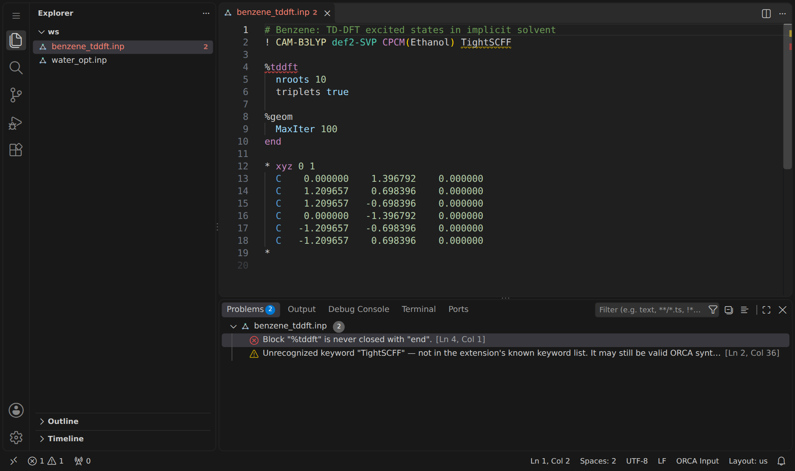
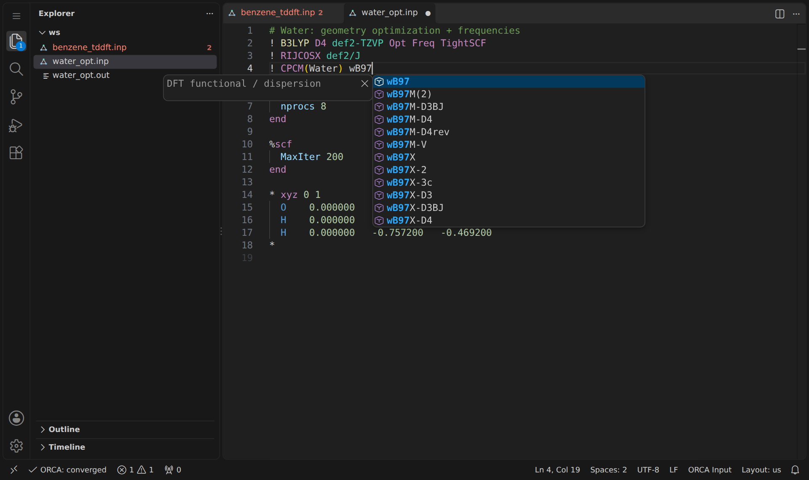
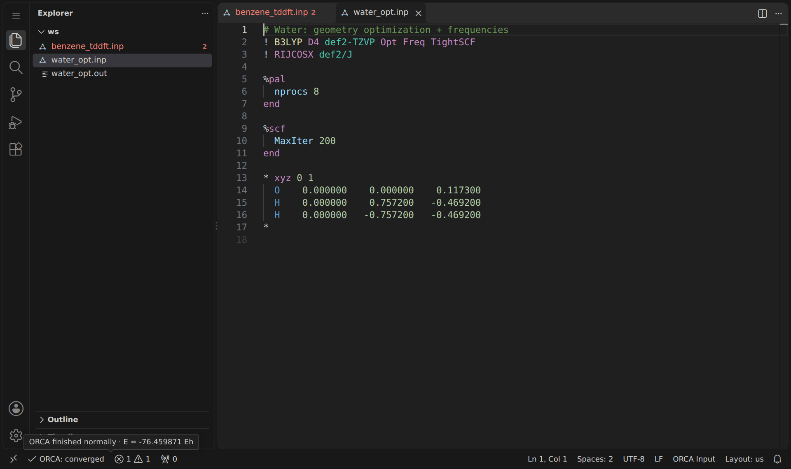
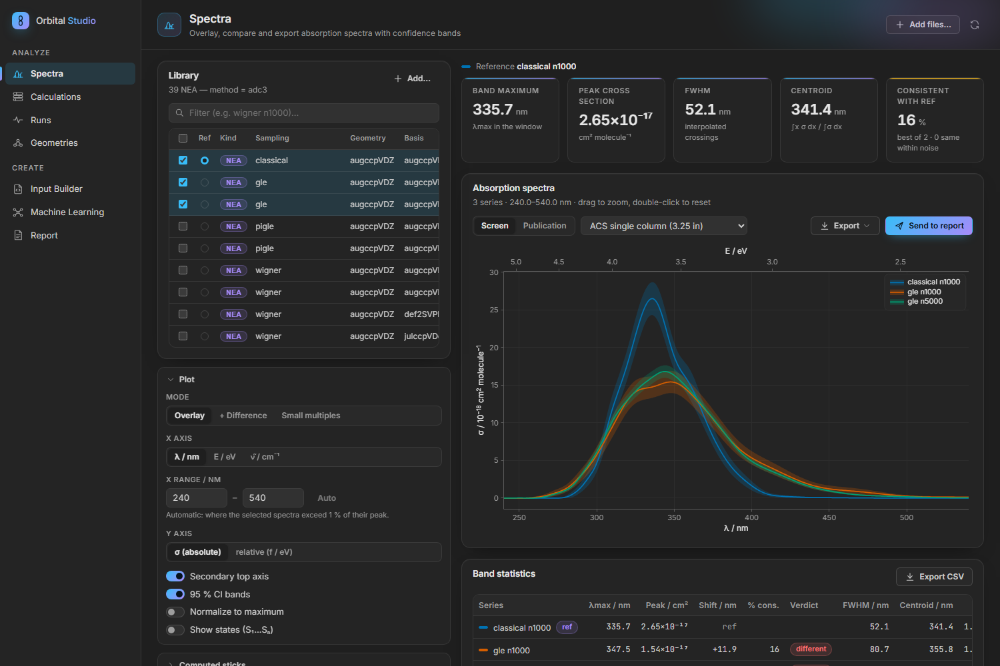
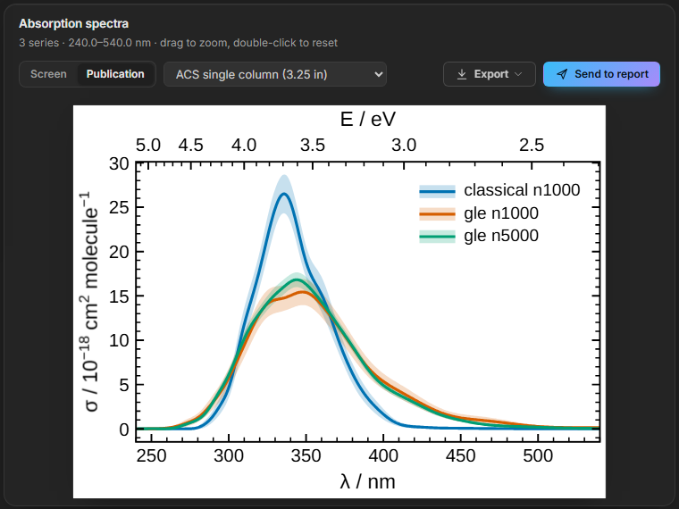
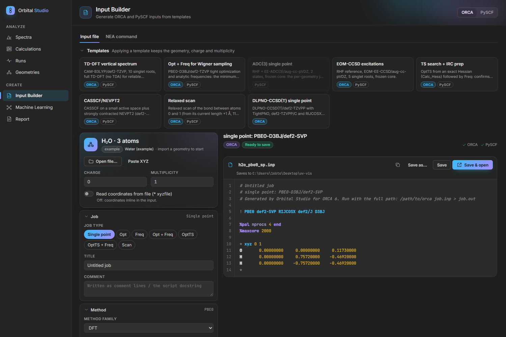
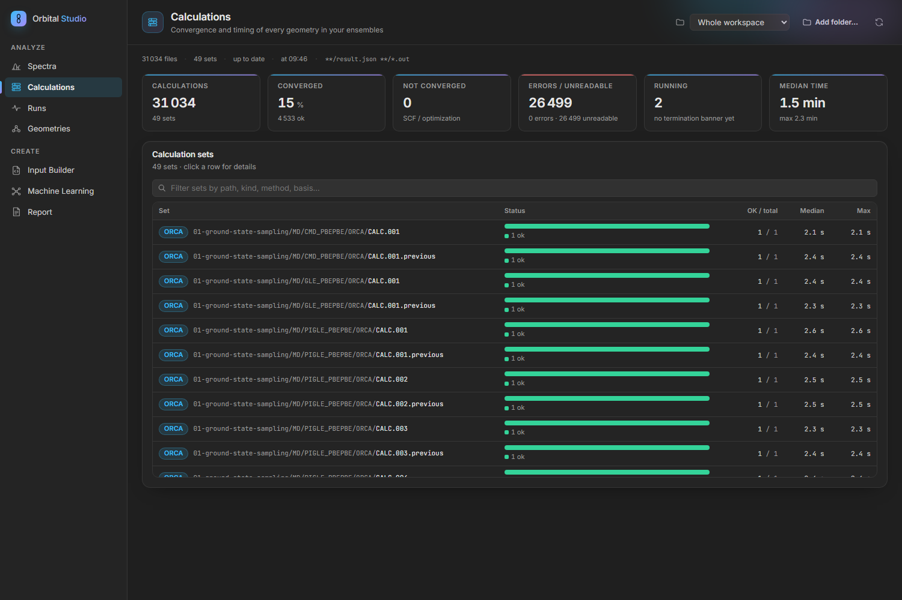
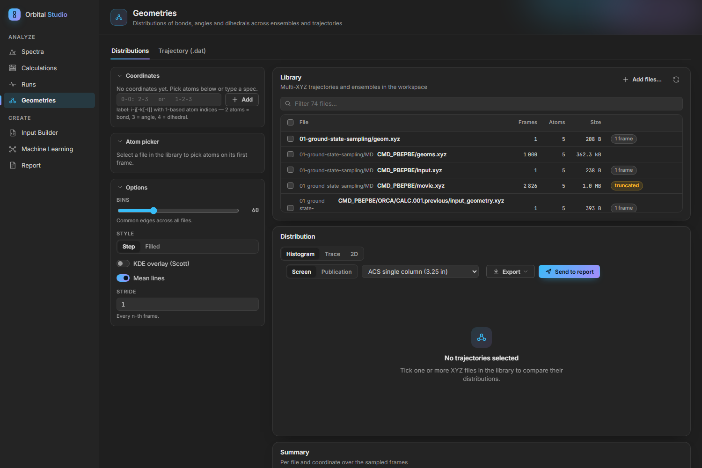
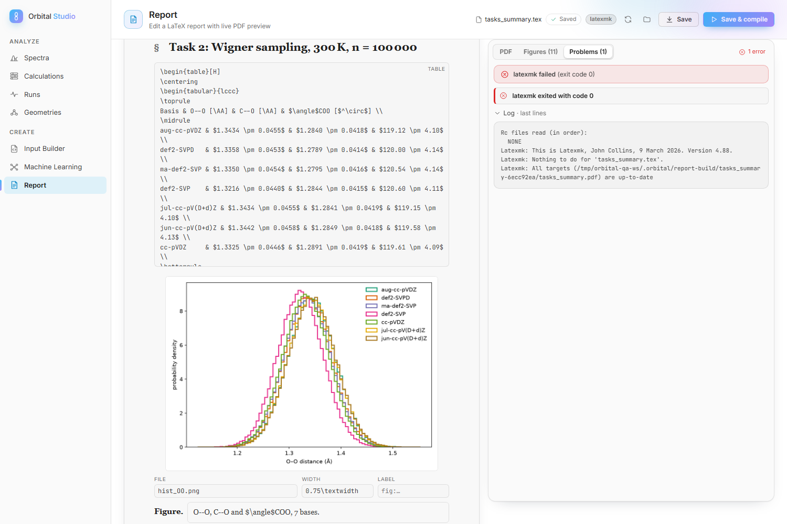

# Orbital — ORCA in VS Code

VS Code extension for [ORCA](https://orcaforum.kofo.mpg.de/) inputs and outputs, plus helpers for the
NEA UV/Vis workflow of [uv-vis](https://github.com/alestoman5/uv-vis) (sampling with
[ABIN](https://github.com/PHOTOX/ABIN) or [SHARC](https://sharc-md.org/) `wigner.py`, spectra with
[PyNEAppLES](https://github.com/stepan-srsen/PyNEAppLES)).

## Install

```bash
npm install && npx vsce package
code --install-extension orca-inp-0.3.0.vsix
```

## How to use

**`.inp` files** — highlighting, completion, hover and live checks (unclosed blocks, charge/multiplicity,
unknown keywords) as you type. Snippets: type `orca-` and pick one.




**`.out` files** — the status bar shows the verdict of the active run (running, failed, saddle point, minimum);
click it for actions: displace along an imaginary mode, IRC input, Molden export for SHARC `wigner.py`,
Wigner readiness report.



**ORCA Runs** (Explorer) — optimizations (`Opt`/`OptTS`) among the `.out` files in the folder of the active
file, with imaginary modes and convergence problems flagged.

## Orbital Studio

*Orbital: Open Orbital Studio* (or the commands below) opens one panel with everything that used to need
a separate web app: spectra, calculation status, running jobs, geometry ensembles, an ORCA/PySCF input
builder, machine learning on ensembles and a LaTeX report editor. It runs inside VS Code (also over
Remote-SSH); Python is only needed for the ML tab.



**Publication-ready figures.** Every chart has a *Screen* and a *Publication* preset. Publication draws
at journal size (ACS 3.25/7 in, RSC 8.3/17.1 cm, Nature 89/183 mm or custom) with a closed frame, inward
ticks, 8 pt Arial-metric text, the Okabe-Ito palette and `quantity / unit` axis labels, and exports
**SVG** (text stays text), **PDF** (fonts embedded) and **PNG at 600 dpi**, plus CSV of the plotted data.
*Send to report* drops the figure into the open `.tex`.



| Tab | What it does |
|---|---|
| **Spectra** | NEA `.cross.dat` / `.molar.dat` (with 95 % CI), experiment, ORCA `.out` or `geom_*/result.json` sticks broadened to an absolute cross section. Overlay, difference vs. reference, small multiples; nm / eV / cm⁻¹; band maximum, FWHM, centroid, integral and a "same within noise" verdict per series. |
| **Calculations** | Status of every `geom_NNNN/result.json` set and ORCA `.out` group (ok / not converged / unreadable / not started), wall-time statistics, problem geometries with links to their logs, `run_config.json` of NEA runs. |
| **Runs** | Calculation processes (ORCA, xtb, Gaussian, PySCF, mpirun, …; local or over SSH), load, Slurm queue, kill with confirmation, live log tail. |
| **Geometries** | Multi-XYZ ensembles and trajectories: watched bonds, angles and dihedrals as histograms, KDE, traces and 2D histograms; ABIN `.dat` columns with drift over the visible range. |
| **Input Builder** | Form + templates for **ORCA 6** `.inp` and runnable **PySCF** `.py` (SP, Opt, Freq, OptTS, scans, TD-DFT/TDA, ADC(2)/ADC(3), EOM-CCSD, CASSCF/NEVPT2, DLPNO-CCSD(T); RI/RIJCOSX, D3/D4, CPCM/SMD) with a live highlighted preview and checks; batch inputs for a whole ensemble; NEA script commands. |
| **Machine Learning** | Regression of a per-molecule target (CSV, e.g. excitation energies) from a multi-XYZ ensemble with `python/ml_worker.py` (scikit-learn): parity plots, learning curves, grid search, run comparison. |
| **Report** | Section editor for a LaTeX report with backups, compile (latexmk / tectonic), PDF preview and figure import. |



Commands that open a tab directly: *Preview Absorption Spectrum* (`.out`, folder), *Plot MD Data*
(ABIN `.dat`), *NEA Run Overview*, *New ORCA/PySCF Input* (`.xyz`, `.inp`, `.out`) and *Edit Report in Orbital Studio*
(`.tex`).

| | |
|---|---|
|  |  |



**NEA runs (uv-vis `scripts/`)** — besides the Studio, right-click a working directory for *Open NEA Run
Outputs* and *Build NEA Script Command* (assembles `from_geometry.py` / `from_ensemble.py` /
`compare_ensembles.py` and types it into a terminal without running it).

Other folder commands: basis-set variants, geometry comparison, PyNEAppLES export, Boltzmann weights.
Settings: `orcaInp.*` in the Settings UI (Studio settings under `orcaInp.studio.*`). Developer notes:
[docs/STUDIO.md](docs/STUDIO.md).

## AI disclosure

Written with [Claude Code](https://claude.com/claude-code) (Anthropic, Claude Opus 5); the author is responsible
for the code.

## License

MIT — see [LICENSE](./LICENSE).
